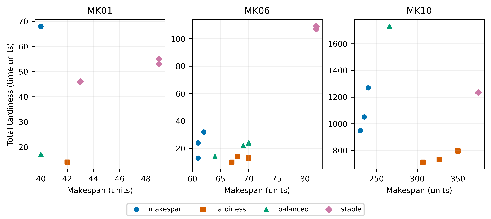
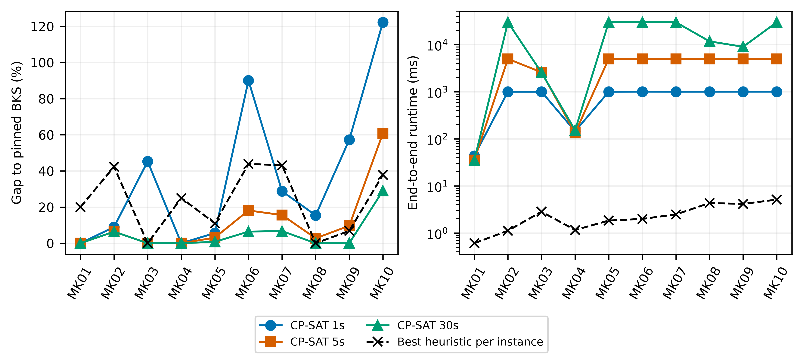
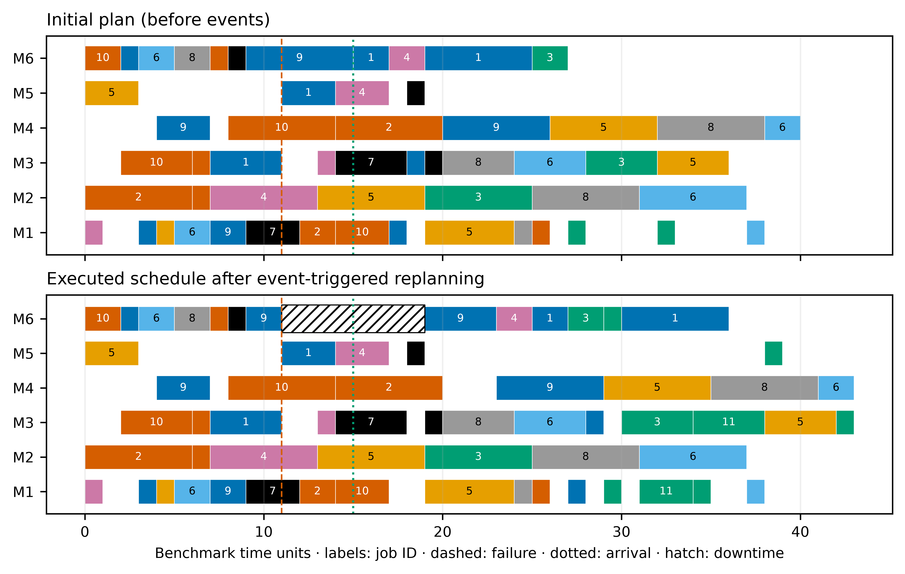
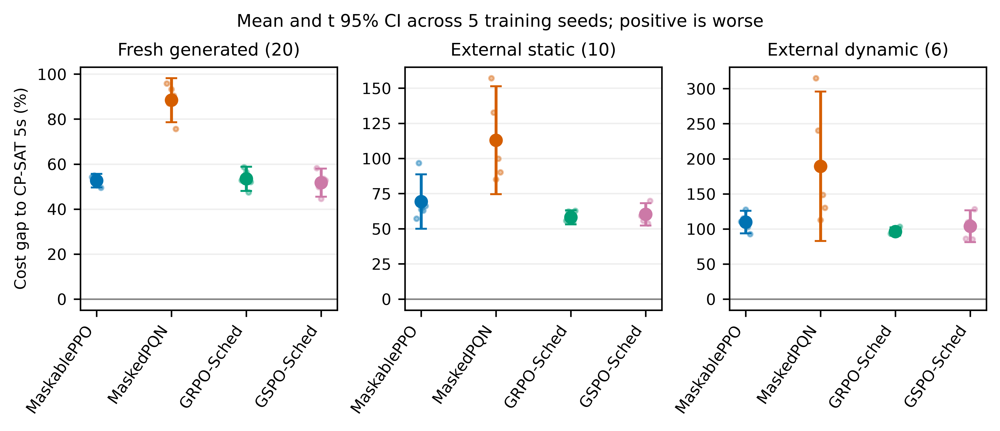
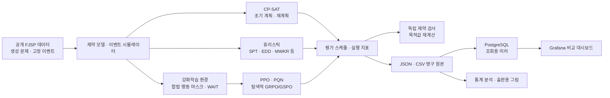

<div align="center">

# Manufacturing Scheduling Lab

### 동적 제조 스케줄링 최적화와 강화학습의 적용 가능성 검증

**CP-SAT · Event-driven Simulation · Reinforcement Learning · Reproducible Evaluation**

공정 순서, 설비 제약, 납기, 고장과 신규 주문을 함께 고려하는 스케줄링 연구 프로젝트

[RL 검토 배경](#왜-강화학습까지-검토했는가) · [주요 결과](#주요-결과) · [시스템 구조](#시스템-구조) · [실험 설계](#실험-설계) · [재현 방법](#재현-방법) · [기술 회고](docs/CASE_STUDY.md)

</div>

---

> **좋은 스케줄을 만드는 것과, 어떤 기술을 선택해야 하는지 증명하는 것을 함께 다뤘습니다.**
> 제약 최적화·휴리스틱·강화학습을 실제로 실행하고 품질, 계산 비용, 제약 준수, 재현성을 비교했습니다. 현재 실험은 CP-SAT을 기본 해법으로 유지하는 판단을 지지합니다.

| 문제 범위 | 구현 범위 | 평가 범위 | 검증 근거 |
| :--- | :--- | :--- | :--- |
| 유연 잡숍 스케줄링(FJSP) | 정적 계획 + 이벤트 기반 재계획 | Brandimarte MK01–MK10 + 생성 문제 | 스케줄 독립 검사 · 원시 결과 보관 |
| 납기·완료 시간·일정 변경의 상충 | CP-SAT + 휴리스틱 + RL 정책 | 추가 RL 비교: 4방법 × 5시드 | 완료 스케줄 900개, 중간 계획 128개 검사 |

## 해결하려는 문제

하나의 제품은 정해진 공정 순서를 따라 가공되지만, 각 공정을 처리할 수 있는 설비와 소요 시간은 다릅니다. 같은 설비에는 동시에 두 작업을 배정할 수 없고, 납기를 맞추면서 전체 생산 완료 시간도 줄여야 합니다. 설비가 고장 나거나 새 주문이 들어오면 이미 진행 중인 작업을 존중하면서 남은 계획을 다시 만들어야 합니다.

이 프로젝트는 다음 세 가지 질문을 실험으로 확인합니다.

1. **제약 최적화만으로 어디까지 해결되는가?** 문제 크기와 계산 시간 예산에 따른 품질을 측정합니다.
2. **무엇을 최적화해야 하는가?** 전체 완료 시간, 납기지연, 일정 변경 비용의 상충을 분석합니다.
3. **학습 기반 정책을 도입할 이유가 있는가?** 빠른 추론뿐 아니라 최종 스케줄 품질과 단순 휴리스틱 대비 이점까지 확인합니다.

## 왜 강화학습까지 검토했는가

**검토한 가설은 “반복되는 작업 배정에서, 사전 학습한 정책으로 실행 중 계산을 줄이면서 스케줄 품질을 유지할 수 있는가?”입니다.** 이를 판단하려면 CP-SAT의 강점과 계산 비용, 제조 의사결정의 순차적 특성, 학습 비용까지 함께 살펴봐야 합니다.

### 1. CP-SAT의 성과를 확인한 뒤, 반복 재계획의 계산 비용을 살펴봄

CP-SAT은 공정·설비 제약을 직접 모델링하고, 계산 예산 안에서 좋은 계획을 탐색하며, 조건에 따라 최적성도 증명할 수 있습니다. 실제로 작은 MK01에서는 최적 완료 시간 40을 확보했습니다. 따라서 이 조건에서는 RL을 추가할 실익이 크지 않았습니다.

검토 범위를 넓힌 계기는 **문제 규모와 이벤트 발생에 따라 계획을 계산하는 부담이 달라진다는 점**입니다. 본 실험의 복합 이벤트·균형 목적함수·5초 예산에서 개별 재계획 시간은 MK01 평균 58.9 ms, MK06 평균 4,828.7 ms였습니다. 고장과 신규 주문에 대응하려면 이런 계산을 다시 수행해야 합니다. [측정 조건과 결과](reports/expanded_results.md)

여기서 RL에 기대한 것은 유사한 문제를 미리 경험해 **상태에서 다음 행동으로 가는 규칙을 학습하고, 운영 시에는 그 정책을 반복 사용하는 방식**입니다. 학습 비용을 먼저 지불하는 대신 반복 의사결정의 계산 부담을 줄일 가능성을 검토했습니다. 다만 현장 응답시간 요구나 실제 재계획 빈도를 측정하지 않았으므로, 위 계산 시간이 운영상 허용 불가능하다거나 학습 비용을 회수할 수 있다고 결론 내리지는 않았습니다. 동적 변화 자체는 이 프로젝트의 rolling-horizon CP-SAT도 처리합니다.

### 2. 작업 배정의 영향이 다음 의사결정까지 이어짐

스케줄링에서는 지금 고른 작업과 설비가 이후의 선택지를 바꿉니다. 예를 들어 두 설비에서 처리할 수 있는 작업을, 다른 긴급 작업이 유일하게 사용할 수 있는 설비에 먼저 배정하면 당장의 처리시간은 짧아도 뒤의 납기지연이 커질 수 있습니다. 이는 의사결정 구조를 설명하기 위한 예시이며 별도 측정 결과는 아닙니다.

이런 문제에서는 **한 번의 선택 이후에 생기는 설비 대기와 최종 납기 성능까지 고려하는 정책**을 학습할 이유가 있습니다. 본 프로젝트의 RL은 시뮬레이터에서 작업을 배정하고 그 결과를 경험하면서, 에피소드 전체의 완료 시간과 납기지연에 연결된 보상을 학습합니다.

| RL 구성 | 이 프로젝트에서의 정의 |
| :--- | :--- |
| 관측 | 현재 알려진 공정·가공시간·납기 정보, 설비 상태, 현재 시각 |
| 행동 | 실행 가능한 공정–설비 조합 선택 또는 WAIT |
| 상태 변화 | 배정에 따른 가공 진행, 완료, 관측 시점에 도달한 고장·복구·주문 도착 |
| 학습 목표 | `gamma=1`에서 누적 보상이 `−(전체 완료 시간 + 평균 납기지연) / 100`이 되도록 구성 |
| 제약 처리 | 합법 행동 마스크로 불가능한 선택을 제한하고, 완성 스케줄은 별도 검사 |

일반적인 지도학습으로 좋은 작업 배정을 모방하려면 학습 대상이 되는 의사결정의 정답이 필요합니다. RL은 시뮬레이터에서 얻는 결과 보상으로 정책을 학습하는 경로를 제공합니다. CP-SAT의 해를 교사 데이터로 사용하는 모방학습도 가능한 대안이지만, 이번에는 비교하지 않았습니다. 또한 미래 이벤트를 보지 못하는 정책이므로 모든 사건을 예측하거나 대응 성능을 보장하는 것은 아닙니다. [환경·보상 정의](reports/expanded_experiment_protocol.md)

### 3. 빠른 정책이 유용한지는 강한 기준선과 비교해야 함

휴리스틱도 학습 없이 빠르게 행동을 선택합니다. 따라서 RL이 빠르게 추론한다는 사실만으로는 도입 이유가 충분하지 않습니다. 비교에서는 다음 질문을 함께 확인했습니다.

| 검토 질문 | 비교 방법 | 해석 기준 |
| :--- | :--- | :--- |
| 결과 품질을 유지하는가? | 같은 문제·이벤트에서 완료 시간과 평균 납기지연 비교 | CP-SAT 대비 품질 손실을 확인 |
| 학습할 만큼 이득이 있는가? | SPT·EDD·MWKR 등 고정 규칙도 함께 평가 | 단순하고 빠른 기준선보다 나은지 확인 |
| 실제 계산 부담이 줄어드는가? | 학습 비용, 행동 추론, 전체 에피소드, 개별 재계획 시간을 구분 | 행동 한 번과 전체 계획 시간을 직접 비교하지 않음 |
| 다른 조건에서도 작동하는가? | 새 생성 문제와 외부 정적·동적 조건을 나눠 평가 | 학습 분포 밖에서의 품질 저하를 확인 |
| 실행 가능한 계획인가? | 저장 스케줄의 선후관계·설비 충돌·고장 처리를 독립 검사 | 목적값이 좋아도 제약을 어긴 계획은 인정하지 않음 |

RL은 온라인 작업 배정을, CP-SAT은 남은 작업의 계획을 생성하므로 의사결정 방식도 다릅니다. 공통의 최종 품질과 계산 시간을 측정하되, 이를 완전히 동일한 기능의 처리속도 비교로 해석하지 않았습니다. 실제 운영 SLA나 허용 품질 손실의 수치 기준은 이번 연구에서 정하지 않았습니다.

### 4. 실험 결과로 기대를 검증하고 채택 여부를 판단

실험에서는 RL이 빠르게 행동을 선택했지만, **현재 학습 예산과 상태 표현에서는 품질 이점을 확보하지 못했습니다.** 네 RL 구성 모두 세 시나리오의 평균 비용에서 SPT보다 낮은 성능을 보였고, CP-SAT을 대체할 근거도 얻지 못했습니다.

따라서 현재 판단은 **CP-SAT과 검증된 휴리스틱을 유지하고, RL은 상태 표현·학습 분포·학습 예산의 효과를 분리해 검증할 연구 후보로 남기는 것**입니다. 이 결과는 RL 일반이 스케줄링에 부적합하다는 증명이 아니라, 이번 구현과 예산에서 도입을 지지하는 증거가 부족하다는 뜻입니다.

이 검토 논리는 RL이라는 접근법을 시험한 이유입니다. 개별 알고리즘 선정에는 별도의 도메인 근거가 필요하며, GRPO·GSPO의 제조 적용 근거가 부족했던 점까지 정당화하지는 않습니다. 해당 방법은 아래 결과에서 탐색적 적용으로 구분합니다.

## 주요 결과

### 1. 완료 시간을 유지하면서 납기지연 75% 감소

MK01, 전체 계획 계산 예산 5초, 솔버 시드 3개의 평균입니다. 완료 시간만 최소화하던 목적함수에 납기지연을 함께 반영했습니다.

| 목적함수 | 전체 완료 시간 ↓ | 총 납기지연 ↓ |
| :--- | ---: | ---: |
| 완료 시간만 최소화 | 40 | 68 |
| 완료 시간 + 납기지연 | **40** | **17** |

`(68 − 17) / 68 = 75%`. 이는 **합성 납기를 부여한 MK01의 제한된 실험 결과**이며, 실제 공장의 생산성 개선율은 아닙니다. 완료 시간만으로는 드러나지 않는 납기 성능 차이를 확인했습니다.



### 2. 작은 문제의 최적해가 큰 문제의 성능을 보장하지는 않음

MK01–MK10에서 CP-SAT의 1·5·30초 솔버 제한과 휴리스틱 5종을 비교해 **240개 평가 기록**을 생성했습니다. 30초 조건에서 MK01·MK03·MK04·MK08·MK09는 각각 3개 시드 모두 최적성을 증명했습니다. MK10은 평균 완료 시간 249로, 고정한 공개 BKS 193 대비 **29.0%** 높았습니다.



BKS는 특정 upstream commit의 최선 알려진 값입니다. **BKS 일치와 해당 실행의 최적성 증명은 구분**합니다. 이 정적 비교는 무힌트 모델이며, 후속 동적 실험의 초기해·fallback 구성과 동일하지 않습니다.

### 3. 고장·신규 주문을 반영한 재계획 구현

이벤트가 발생하면 관측된 정보로 잔여 작업을 다시 계획합니다. 시작된 작업은 고정하고, 고장 중인 작업은 같은 설비에서 일시정지 후 재개합니다. 미래 신규 주문이나 고장 정보는 미리 제공하지 않습니다.



MK01 복합 이벤트·균형 목적함수·5초 예산에서 개별 재계획의 평균 계산 시간은 **58.9 ms**였습니다. 같은 조건의 MK06은 **4,828.7 ms**였습니다. 문제별로 필요한 계산 예산이 크게 달랐고, 일정 변경 억제는 완료 시간·납기와 상충했습니다. [동적 실험 상세](reports/expanded_results.md)

### 4. 강화학습은 실제로 학습·평가했으며, 채택 근거는 확보하지 못함

PPO를 동일 비교 조건으로 재학습하고 PQN 및 두 가지 탐색적 정책 학습 변형을 추가했습니다. 각 방법은 **5개 시드 × 65,536 환경 전이**로 학습했으며 총 **1,310,720 전이**를 사용했습니다. 아래는 CP-SAT 5초 대비 문제별 상대 비용 차이의 평균입니다. **양수는 CP-SAT보다 나쁜 결과**입니다.

| 방법 | 새 생성 문제 20개 | 외부 정적 문제 10개 | 외부 동적 조건 6개 | 비교 목적 |
| :--- | ---: | ---: | ---: | :--- |
| Maskable PPO | +52.6% | +69.4% | +109.7% | 행동 마스킹을 적용한 정책 학습 기준선 |
| Masked PQN | +88.4% | +113.0% | +189.3% | 온라인 Q 학습 계열 비교 |
| GRPO-Sched | +53.5% | +58.1% | +96.4% | 그룹 상대 보상의 탐색적 적용 |
| GSPO-Sched | +51.7% | +60.3% | +103.9% | 궤적 단위 정책 업데이트의 탐색적 적용 |

비용은 `(전체 완료 시간 + 작업당 평균 납기지연) / 100`입니다. GRPO/GSPO와 PPO를 직접 짝지은 차이의 학습 시드 기반 95% 구간은 모든 시나리오에서 0을 포함했습니다. **확실한 우월성을 확인하지 못했습니다.** 단순 SPT 휴리스틱도 세 시나리오 모두에서 네 RL 구성보다 평균 비용이 낮았습니다.

**GRPO·GSPO는 언어모델 학습에서 제안된 방법을 스케줄 궤적에 적용한 자체 연구 구현입니다.** 제조 분야의 검증된 대표 알고리즘으로 제시하지 않습니다. 최신성만으로 비교 대상을 고른 근거가 부족했다는 점을 회고에 기록하고, 주된 최적화 성과와 구분했습니다.



상대 비율의 평균과 원시 비용의 평균은 문제별 가중치가 달라 순위가 달라질 수 있습니다. 이 표만으로 GSPO를 최고 방법으로 선정하지 않습니다. [전체 통계·휴리스틱 비교](reports/multi_rl_results.md) · [사전 고정 프로토콜](reports/multi_rl_protocol.md)

## 시스템 구조



| 구성 | 구현 내용 | 코드 |
| :--- | :--- | :--- |
| 제약 최적화 | 공정 선후관계, 설비 적합성·중복 금지, 납기, 일정 변경 비용 | [rolling_cpsat.py](src/algorithms/rolling_cpsat.py) |
| 동적 시뮬레이션 | 신규 주문, 고장·복구, 관측 정보 제한, 진행 작업 고정 | [rolling.py](src/simulator/rolling.py) |
| RL 환경 | 이벤트 시점의 의사결정, WAIT, 합법 행동 마스킹 | [event_fjsp.py](src/environments/event_fjsp.py) |
| 학습 비교 | PPO 실행, masked Q(λ), 그룹·궤적 정책 목적함수 | [run_multi_rl.py](src/evaluation/run_multi_rl.py) · [recent_rl.py](src/algorithms/recent_rl.py) |
| 실험 기록 | run_id, 시드, 설정, 소스 해시, JSON·CSV·DB 대조 | [campaign.py](src/evaluation/campaign.py) |
| 독립 검증 | 저장된 계획에서 제약과 목적값을 별도 재계산 | [audit_extended_results.py](scripts/audit_extended_results.py) |
| 관측·분석 | Grafana, Prometheus, 통계표, PDF·SVG·PNG | [grafana](grafana/) · [분석 스크립트](scripts/analyze_multi_rl.py) |

**기술:** Python · OR-Tools · PyTorch · Gymnasium · Stable-Baselines3/sb3-contrib · NumPy/Pandas/SciPy · PostgreSQL · Grafana · Prometheus · Docker Compose · pytest

## 실험 설계

| 캠페인 | 설계 | 보관 위치 |
| :--- | :--- | :--- |
| 정적 확장 | 10문제 × 3시드 × 8조건 = 240평가 | [expanded_static](results/expanded_static/) |
| 목적함수·동적 | 목적함수 72평가 + 동적 144평가 | [objectives_dynamic](results/objectives_dynamic/) |
| 초기 PPO 파일럿 | 5시드 × 32,768전이 | [ppo_pilot](results/ppo_pilot/) |
| 추가 RL 비교 | 20모델 × 36조건 = 720 RL 평가 + 180 기준선 평가 | [multi_rl](results/multi_rl/20261117T101814Z-eab66180/) |

- **동일 외생 조건:** 비교 방법에 같은 문제·이벤트 tape를 적용했습니다.
- **학습과 평가 분리:** 추가 비교의 생성 학습 bank·검증·새 생성 평가 시드를 분리했습니다. 이미 확인한 MK 계열은 외부 전이 평가로 표시했습니다.
- **고정 예산:** 마지막 체크포인트를 평가했습니다. 테스트 결과를 보고 설정이나 좋은 시드를 선택하지 않았습니다.
- **작업 단위 구분:** 한 행동의 추론 지연, 전체 에피소드 계산 시간, CP-SAT 개별 재계획 시간을 구분했습니다.
- **재현성:** 원시 스케줄, 소스·데이터·모델 해시, 라이브러리 버전, 실패와 감사 경고를 보관했습니다.

추가 RL 비교는 65,536전이의 제한된 파일럿입니다. 같은 전이 수라도 알고리즘별 데이터 방문 횟수·망 구성·계산량은 다릅니다. 학습 수렴이나 일반적인 알고리즘 우열을 주장하지 않습니다.

## 검증과 신뢰성

| 검증 항목 | 확인 결과 | 근거 |
| :--- | :--- | :--- |
| 단위·통합 테스트 | 41개 통과 | [tests](tests/) |
| 추가 RL 비교의 완료 스케줄 | 900개 검사, 제약 위반 0건 | [독립 감사](reports/multi_rl_artifact_audit.json) |
| 같은 비교의 중간 CP 계획 | 128개 검사, 제약 위반 0건 | [독립 감사](reports/multi_rl_artifact_audit.json) |
| 체크포인트 재로딩 | 20/20 동일 검증 스케줄 | [평가 기록](results/multi_rl/20261117T101814Z-eab66180/) |
| JSON·CSV·DB 기록 | 1,325개 레코드의 모든 셀 일치 | [DB 대조](results/multi_rl/20261117T101814Z-eab66180/db_validation.json) |

제약 위반이 없다는 사실과 솔버 응답에 경고가 없다는 사실은 다릅니다. 추가 RL 비교의 솔버 응답 감사 경고 **1건**은 보존했으며 실제 스케줄은 별도 검사했습니다. 이전 확장 실험의 경고와 검증 수치는 해당 보고서에 따로 기록되어 있습니다.

## 재현 방법

실측 환경은 **Apple M5 · 16 GiB · Python 3.11.15 · CPU**입니다. 정확한 패키지는 [학습 환경 lock](requirements.training.lock.txt)에 기록되어 있습니다. 다른 OS·장비의 동일 성능이나 비트 단위 재현은 보장하지 않습니다.

Python 3.11, `uv`, Docker Compose를 준비한 뒤:

```bash
git clone https://github.com/BaekJiHeon/manufacturing-scheduling-lab.git
cd manufacturing-scheduling-lab
bash scripts/setup_training.sh
bash scripts/python.sh -m pytest -q --basetemp=runtime/pytest
```

**저장 결과를 검사하고 그림을 다시 생성**하려면:

```bash
bash scripts/python.sh scripts/audit_extended_results.py
bash scripts/python.sh scripts/analyze_multi_rl.py
bash scripts/python.sh scripts/verify_multi_rl_figures.py
```

**실험 데이터를 대시보드로 조회**하려면:

```bash
bash scripts/start_monitoring.sh
```

[로컬 Grafana](http://localhost:3000/d/research-multi-rl/)에서 실행을 선택합니다. 기본 계정은 `admin / admin_local_only`이며 Compose 포트는 localhost에 바인딩됩니다. GitHub 자체에서 이 대시보드가 호스팅되는 것은 아닙니다.

**새 학습·평가 실행**은 DB 시작 후 수행합니다. 기존 결과를 덮어쓰지 않고 새 `run_id`가 생성됩니다.

```bash
bash scripts/python.sh -m src.evaluation.run_multi_rl
bash scripts/python.sh scripts/analyze_multi_rl.py
```

추가 실행, 재개 정책, DB 복구, 체크포인트 범위는 [재현 안내](docs/REPRODUCIBILITY.md)를 참조하세요. 모델 가중치는 저장소에 포함하지 않으므로 기존 모델을 바로 불러오려면 별도 체크포인트가 필요합니다. 원시 결과 감사와 통계 재생성에는 가중치가 필요하지 않습니다.

## 범위와 다음 단계

이 프로젝트는 **공개 벤치마크와 합성 이벤트 기반 연구 프로토타입**입니다. 실제 공장 배포나 매출·생산성 개선을 검증한 사례는 아닙니다. 고장 발생 시 정확한 복구 시각을 알며, 계산하는 동안 시뮬레이션 시간은 정지합니다. 가공시간 불확실성과 실제 설비 연결은 포함하지 않았습니다.

후속 과제는 공정·설비 관계를 반영하는 상태 표현, 학습 문제 크기와 평가 분포의 차이, 학습 예산 효과를 **각각 분리해 검증**하는 것입니다. GNN 정책·모방학습·CP-SAT과의 결합은 아직 구현 성과가 아닌 연구 후보입니다.

## 더 읽기

- [기술 회고 및 포트폴리오 상세](docs/CASE_STUDY.md) — 설계 결정, 문제 해결, 결과 해석
- [확장 벤치마크 결과](reports/expanded_results.md) · [실험 정의](reports/expanded_experiment_protocol.md)
- [추가 RL 결과](reports/multi_rl_results.md) · [실험 정의](reports/multi_rl_protocol.md)
- [데이터 출처](data/raw/provenance.json) · [MK02–MK10 및 BKS 출처](data/raw/brandimarte/provenance.json)
- [OR-Tools CP-SAT](https://developers.google.com/optimization/cp/cp_solver) · [Maskable PPO](https://sb3-contrib.readthedocs.io/en/master/modules/ppo_mask.html)
- [PQN](https://arxiv.org/abs/2407.04811) · [GRPO / DeepSeekMath](https://arxiv.org/abs/2402.03300) · [GSPO](https://arxiv.org/abs/2507.18071)

데이터는 [ScheduleOpt/benchmarks](https://github.com/ScheduleOpt/benchmarks)의 고정 commit에서 가져왔으며, 원본 출처와 [CC BY-SA 4.0 라이선스](data/raw/SOURCE_LICENSE.txt)를 함께 보관합니다. 원본 벤치마크에 없는 납기·동적 이벤트는 이 프로젝트에서 생성했습니다.
