# 전체 Figure: 한국어 해설과 원본 파일

[프로젝트 README](../README.md) · [한국어 기술 보고서 PDF](../docs/manufacturing_scheduling_report_ko.pdf) · [편집용 Word](../docs/manufacturing_scheduling_report_ko.docx)

**저장된 연구 그림 23종을 빠짐없이 모았습니다.** 각 그림은 PNG 미리보기와 SVG·PDF 원본을 제공합니다. 보고서 본문은 핵심 그림 2종을 사용하는 12쪽 설명 자료이며, 이 페이지는 나머지 초기 실험까지 포함한 전체 그림 부록입니다. 아래 그림 번호는 이 모음의 번호로, 보고서 내부 번호와 별개입니다.

## 읽는 방법

완료 시간(makespan)은 마지막 작업이 끝나는 시각, 납기지연(tardiness)은 작업이 납기보다 늦어진 시간입니다. 둘 다 **벤치마크 시간 단위**이며 실제 초 단위로 환산하지 않았습니다. `runtime_ms`는 컴퓨터에서 계산에 쓴 밀리초입니다. RL 목적 비용은 `(완료 시간 + 작업당 평균 납기지연) / 100`이고 낮을수록 좋습니다. CP-SAT 대비 상대 비용 차이가 양수이면 CP-SAT보다 나쁜 결과입니다.

처음 읽는다면 그림 1–4로 최적화 문제와 재계획을 이해한 뒤, 그림 5–8로 RL의 도입 가능성을 살펴보세요. 초기 PPO와 초기 기준선 그림은 연구가 확장된 과정을 보여줍니다. 실제 공장 데이터나 운영 개선율을 측정한 자료는 아닙니다.

| 구분 | 그림 | 수량 |
| :--- | :--- | ---: |
| [1. 문제 규모·목적함수·동적 재계획](#expanded) | 1–4 | 4 |
| [2. 추가 강화학습 4종 비교](#multi-rl) | 5–8 | 4 |
| [3. 초기 PPO 파일럿](#ppo-pilot) | 9–11 | 3 |
| [4. 초기 MK01 CP-SAT 기준선](#initial-cpsat) | 12–16 | 5 |
| [5. 최초 휴리스틱 구현과 납기 민감도](#legacy) | 17–23 | 7 |

총 **23종 × 3형식 = 69개** 이미지 파일입니다. 기존 CPU·메모리·학습 진행 상태 대시보드 화면은 이 연구 그림 모음에 포함하지 않습니다.

## 1. 문제 규모·목적함수·동적 재계획

정적 확장 240평가와 목적함수·동적 216평가를 다룹니다. CP-SAT의 계산 예산과 최적화 목표를 바꿨을 때의 결과입니다. [상세 결과](../reports/expanded_results.md) · [실험 정의](../reports/expanded_experiment_protocol.md) · [그림 출처 manifest](publication/20261117T060744Z-43676ed5/manifest.json)

### 그림 1. 문제 규모와 계산 예산에 따른 품질·계산 시간

MK01–MK10에서 CP-SAT 1·5·30초 제한과 문제별 최선 휴리스틱을 비교합니다. 왼쪽은 고정한 BKS 대비 완료 시간 차이, 오른쪽은 전체 스케줄 계산 시간입니다. 오른쪽 축은 로그 척도입니다. 문제별 최선 휴리스틱은 평가 후 고른 참고선이며, 미리 선택 가능한 단일 정책의 성과가 아닙니다. BKS 일치와 솔버의 최적성 증명도 구분해야 합니다.

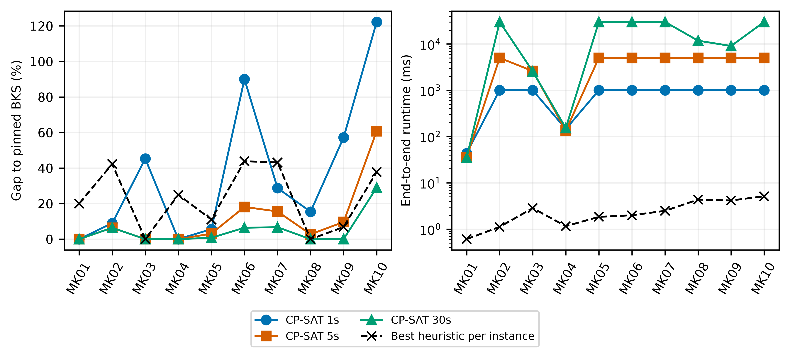

[PNG 크게 보기](publication/20261117T060744Z-43676ed5/01_scalability.png) · [SVG 벡터 원본](publication/20261117T060744Z-43676ed5/01_scalability.svg) · [PDF 원본](publication/20261117T060744Z-43676ed5/01_scalability.pdf)

### 그림 2. 완료 시간·납기지연 목적의 상충

MK01·MK06·MK10의 5초 계획 예산에서 완료 시간, 납기지연, 균형, 안정성 목적을 비교합니다. 왼쪽 아래일수록 완료 시간과 총 납기지연이 작습니다. MK01에서는 균형 목적이 완료 시간 40을 유지하면서 총 납기지연 평균을 68에서 17로 줄였습니다. 이는 합성 납기를 사용한 해당 조건의 결과입니다.

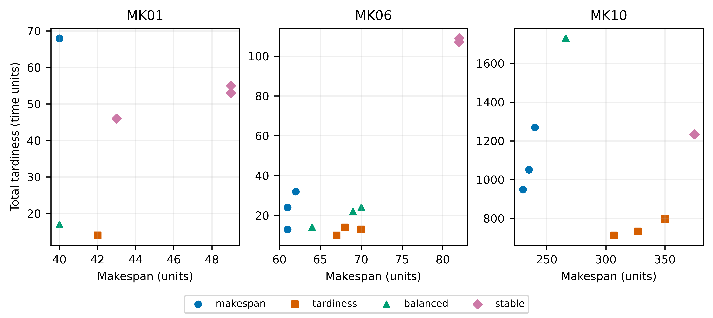

[PNG 크게 보기](publication/20261117T060744Z-43676ed5/02_objective_tradeoff.png) · [SVG 벡터 원본](publication/20261117T060744Z-43676ed5/02_objective_tradeoff.svg) · [PDF 원본](publication/20261117T060744Z-43676ed5/02_objective_tradeoff.pdf)

### 그림 3. 일정 변경 억제와 실제 완료 시간의 상충

동일한 복합 이벤트 조건에서 MK01·MK06을 비교합니다. 가로축은 누적 정규화 일정 변경 비용, 세로축은 실행 후 완료 시간입니다. 계획을 덜 바꾸는 것이 항상 더 빨리 끝나는 결과로 이어지지는 않습니다.

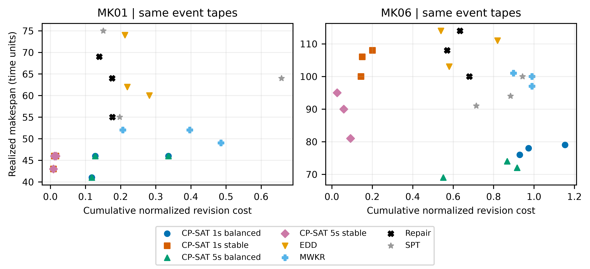

[PNG 크게 보기](publication/20261117T060744Z-43676ed5/03_dynamic_stability.png) · [SVG 벡터 원본](publication/20261117T060744Z-43676ed5/03_dynamic_stability.svg) · [PDF 원본](publication/20261117T060744Z-43676ed5/03_dynamic_stability.pdf)

### 그림 4. 고장·신규 주문 전후의 스케줄

MK01·안정성 목적·5초 예산·시드 0의 사례입니다. 위는 이벤트 전 최초 계획, 아래는 재계획을 반영한 실행 스케줄입니다. 막대는 설비별 가공 구간, 점선은 주문 도착, 파선은 고장 발생, 빗금은 설비 중단 구간을 뜻합니다. 한 사례의 작동 설명이며 전체 실험 평균은 아닙니다.

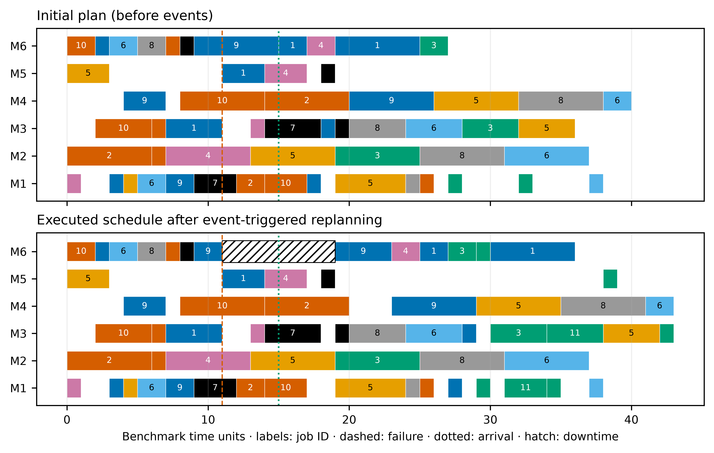

[PNG 크게 보기](publication/20261117T060744Z-43676ed5/04_dynamic_gantt.png) · [SVG 벡터 원본](publication/20261117T060744Z-43676ed5/04_dynamic_gantt.svg) · [PDF 원본](publication/20261117T060744Z-43676ed5/04_dynamic_gantt.pdf)

## 2. 추가 강화학습 4종 비교

Maskable PPO·Masked PQN·GRPO-Sched·GSPO-Sched를 각각 5개 학습 시드, 65,536 환경 전이로 실행했습니다. 새 생성 문제 20개·외부 정적 문제 10개·외부 동적 조건 6개에서 최종 체크포인트를 평가했습니다. GRPO·GSPO는 언어모델 학습 방법을 스케줄 궤적에 옮긴 탐색적 구현이며, 제조 분야에서 검증된 대표 알고리즘이라는 뜻은 아닙니다. [상세 결과](../reports/multi_rl_results.md) · [고정 프로토콜](../reports/multi_rl_protocol.md) · [그림 출처 manifest](publication/20261117T101814Z-eab66180/manifest.json)

### 그림 5. 학습 전이 수에 따른 검증 비용

네 방법의 학습 시드별 원시 검증 측정점입니다. 세로축 비용은 낮을수록 좋습니다. 곡선을 평활화하지 않았으며, 제한된 학습 예산의 변화만 보여줍니다. 이 그림으로 학습 수렴을 확정하지 않습니다.

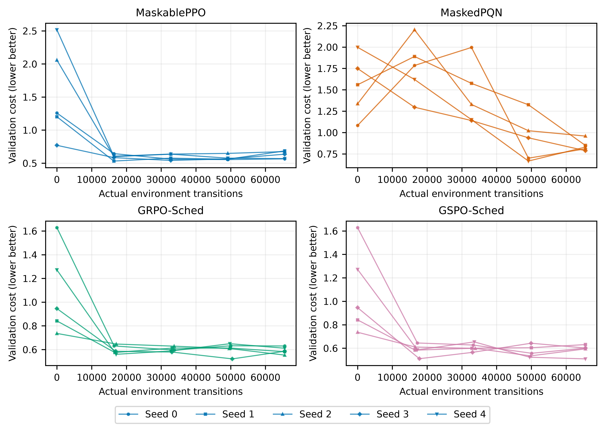

[PNG 크게 보기](publication/20261117T101814Z-eab66180/01_multi_rl_learning_raw.png) · [SVG 벡터 원본](publication/20261117T101814Z-eab66180/01_multi_rl_learning_raw.svg) · [PDF 원본](publication/20261117T101814Z-eab66180/01_multi_rl_learning_raw.pdf)

### 그림 6. CP-SAT 대비 품질 차이와 불확실성

세 평가 시나리오에서 CP-SAT 5초 대비 문제별 상대 비용 차이를 집계합니다. 양수는 CP-SAT보다 비용이 높다는 뜻입니다. 점과 구간은 5개 학습 시드의 평균과 Student-t 95% 신뢰구간을 나타냅니다. 개별 문제 전체의 모집단 불확실성을 나타내는 구간은 아닙니다. GRPO·GSPO와 PPO의 별도 짝지은 차이 구간은 모두 0을 포함해 확실한 우월성을 확인하지 못했습니다.

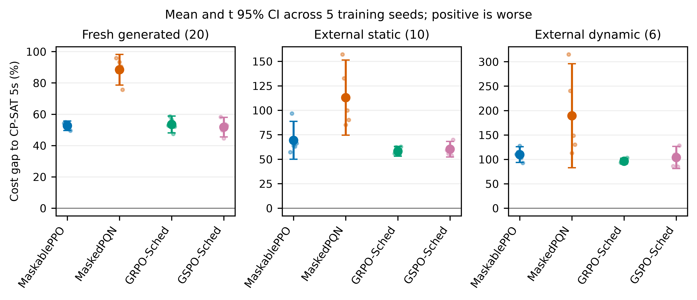

[PNG 크게 보기](publication/20261117T101814Z-eab66180/02_multi_rl_quality.png) · [SVG 벡터 원본](publication/20261117T101814Z-eab66180/02_multi_rl_quality.svg) · [PDF 원본](publication/20261117T101814Z-eab66180/02_multi_rl_quality.pdf)

### 그림 7. 품질과 전체 에피소드 계산 시간 비교

CP-SAT·SPT·EDD·MWKR과 네 RL 방법을 함께 놓았습니다. 왼쪽 아래일수록 계산 시간이 짧고 원시 목적 비용이 낮습니다. 가로축은 로그 척도의 전체 에피소드 계산 시간이며 행동 한 번의 추론 지연이 아닙니다. 학습 비용은 포함하지 않습니다. 세 시나리오 모두 SPT 평균 비용이 네 RL 구성보다 낮아, 빠른 추론만으로 RL 도입을 정당화하기 어렵습니다.

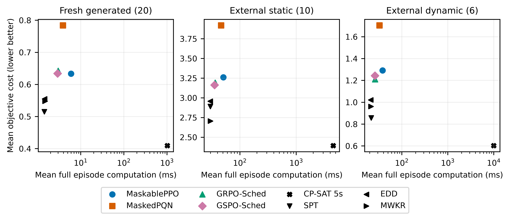

[PNG 크게 보기](publication/20261117T101814Z-eab66180/03_multi_rl_quality_latency.png) · [SVG 벡터 원본](publication/20261117T101814Z-eab66180/03_multi_rl_quality_latency.svg) · [PDF 원본](publication/20261117T101814Z-eab66180/03_multi_rl_quality_latency.pdf)

### 그림 8. 외부 MK01–MK10으로의 전이 성능

외부 정적 문제별 CP-SAT 5초 대비 상대 비용 차이를 학습 시드에 대해 평균했습니다. 양수는 CP-SAT보다 나쁩니다. 인스턴스마다 작업 수·설비 수·가공 구조가 함께 달라지므로 차이를 문제 크기 하나의 인과 효과로 해석하지 않습니다.

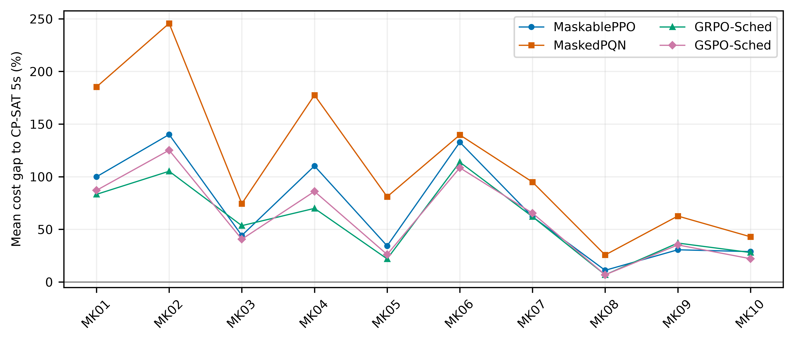

[PNG 크게 보기](publication/20261117T101814Z-eab66180/04_multi_rl_external_transfer.png) · [SVG 벡터 원본](publication/20261117T101814Z-eab66180/04_multi_rl_external_transfer.svg) · [PDF 원본](publication/20261117T101814Z-eab66180/04_multi_rl_external_transfer.pdf)

## 3. 초기 PPO 파일럿

후속 4종 비교보다 먼저 수행한 5시드 × 32,768 전이 실험입니다. 학습 예산과 평가 문제가 후속 비교와 다르므로 두 실험의 숫자를 그대로 합치거나 알고리즘 개선율로 해석하지 않습니다. [파일럿 결과](../reports/expanded_results.md) · [원시 기록](../results/ppo_pilot/20261117T060744Z-43676ed5/)

### 그림 9. 초기 PPO의 검증 비용·완료 시간 변화

학습 시드별 원시 검증값과 5시드 평균을 표시합니다. 초기에 비용이 감소했지만 마지막 측정점까지 단조롭게 개선되지는 않았습니다. 파일럿에서 학습이 진행되었다는 관측과 충분히 수렴했다는 주장을 구분합니다.

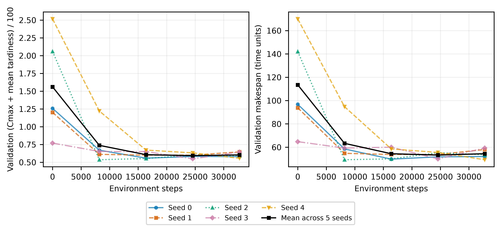

[PNG 크게 보기](publication/20261117T060744Z-43676ed5/05_ppo_validation_raw.png) · [SVG 벡터 원본](publication/20261117T060744Z-43676ed5/05_ppo_validation_raw.svg) · [PDF 원본](publication/20261117T060744Z-43676ed5/05_ppo_validation_raw.pdf)

### 그림 10. 초기 PPO의 품질 손실과 계산 시간

왼쪽은 세 시나리오의 CP-SAT 5초 대비 상대 비용 차이와 학습 시드 기반 95% 구간입니다. 오른쪽은 방법별 전체 평가 에피소드 계산 시간의 중앙값으로, 로그 척도입니다. 품질은 시나리오별로, 시간은 평가 기록을 방법별로 묶어 집계하므로 두 패널을 동일한 단일 조건의 대응점처럼 읽지 않습니다.

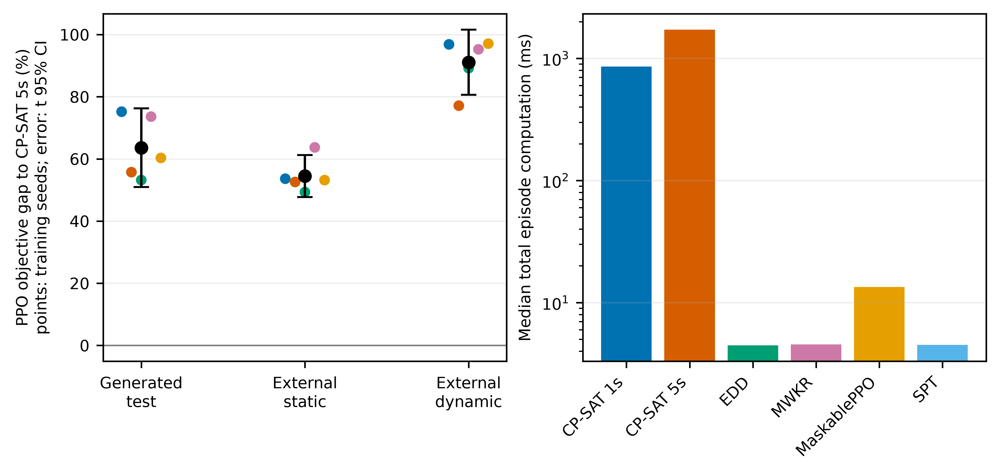

[PNG 크게 보기](publication/20261117T060744Z-43676ed5/06_ppo_quality_runtime.png) · [SVG 벡터 원본](publication/20261117T060744Z-43676ed5/06_ppo_quality_runtime.svg) · [PDF 원본](publication/20261117T060744Z-43676ed5/06_ppo_quality_runtime.pdf)

### 그림 11. 초기 PPO의 외부 문제 전이

MK01–MK10별 품질 차이와 5개 학습 시드의 변동을 표시합니다. 가로축에는 작업 수 × 설비 수도 적었습니다. 학습 범위는 4–10개 작업·3–6대 설비입니다. 외부 문제에서의 품질 손실을 보여주며, 규모 증가만을 분리한 통제 실험은 아닙니다.

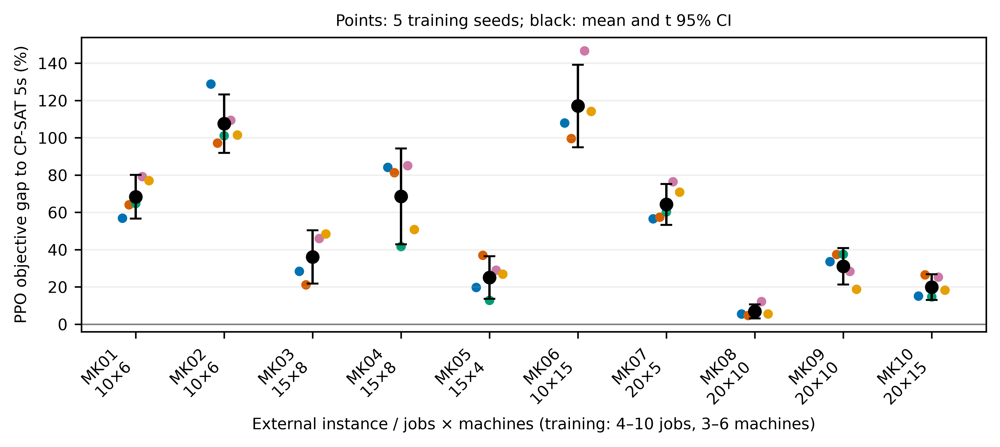

[PNG 크게 보기](publication/20261117T060744Z-43676ed5/07_external_scale_transfer.png) · [SVG 벡터 원본](publication/20261117T060744Z-43676ed5/07_external_scale_transfer.svg) · [PDF 원본](publication/20261117T060744Z-43676ed5/07_external_scale_transfer.pdf)

## 4. 초기 MK01 CP-SAT 기준선

하나의 MK01, 고정된 합성 납기, 방법별 5개 알고리즘 시드의 정적 실험입니다. CP-SAT은 이 단계에서 완료 시간만 최소화했습니다. 아래 자료는 초기 단계의 기록이며, 당시 보고서에 적힌 미실행 항목은 이후 확장 실험에서 진행되었습니다. [당시 결과](../reports/phase1_results.md) · [원시 기록](../results/phase1_cpsat/20261117T053721Z-c77ef3ce/) · [그림 출처 manifest](publication/20261117T053721Z-c77ef3ce/manifest.json)

### 그림 12. 초기 기준선의 전체 완료 시간

방법별 관측값과 평균, 공개 기준값 40을 비교합니다. CP-SAT은 15회 실행 모두 완료 시간 40의 최적성을 증명했습니다. 동일 MK01의 반복이며 서로 다른 15개 공장 문제를 해결한 결과는 아닙니다.

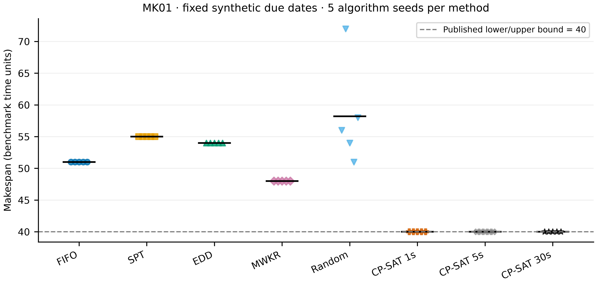

[PNG 크게 보기](publication/20261117T053721Z-c77ef3ce/makespan_benchmark.png) · [SVG 벡터 원본](publication/20261117T053721Z-c77ef3ce/makespan_benchmark.svg) · [PDF 원본](publication/20261117T053721Z-c77ef3ce/makespan_benchmark.pdf)

### 그림 13. 완료 시간 최소화만으로 해결되지 않는 납기지연

같은 합성 납기 아래 방법별 총 납기지연을 비교합니다. 완료 시간만 최적화한 CP-SAT이 납기지연까지 가장 작지는 않았습니다. 이 관측이 이후 목적함수 확장으로 이어졌습니다.

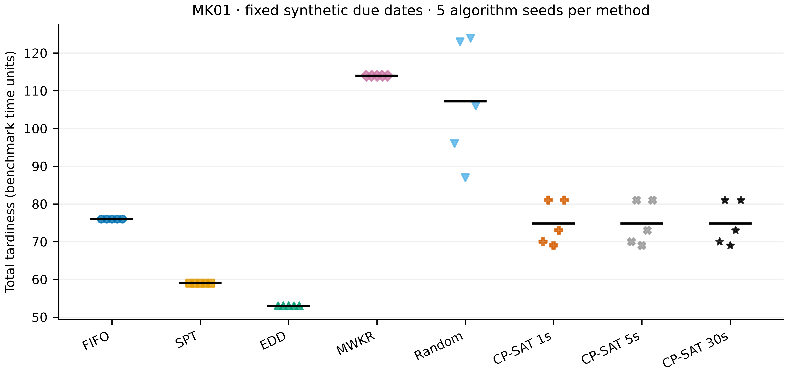

[PNG 크게 보기](publication/20261117T053721Z-c77ef3ce/tardiness_benchmark.png) · [SVG 벡터 원본](publication/20261117T053721Z-c77ef3ce/tardiness_benchmark.svg) · [PDF 원본](publication/20261117T053721Z-c77ef3ce/tardiness_benchmark.pdf)

### 그림 14. 초기 기준선의 스케줄 계산 시간

모델 구성·스케줄 생성·검증을 포함한 계산 시간을 로그 축으로 표시합니다. 파일 저장·그림 생성·패키지 import는 제외합니다. 그룹 실행 순서와 초기화 효과가 있으므로 정밀한 마이크로벤치마크로 해석하지 않습니다. 1·5·30초는 제한값이며 실제 소요 시간과 다릅니다.

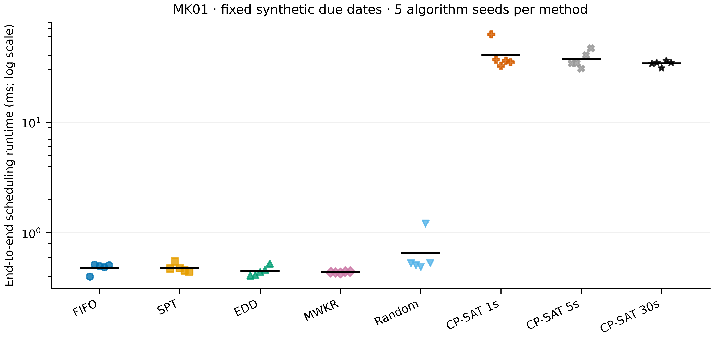

[PNG 크게 보기](publication/20261117T053721Z-c77ef3ce/runtime_benchmark.png) · [SVG 벡터 원본](publication/20261117T053721Z-c77ef3ce/runtime_benchmark.svg) · [PDF 원본](publication/20261117T053721Z-c77ef3ce/runtime_benchmark.pdf)

### 그림 15. 완료 시간과 총 납기지연의 관측 조합

각 방법이 만든 완료 시간·납기지연 쌍입니다. 목적을 바꾸어 탐색한 파레토 전선이 아니라 완료 시간 최소화 기준선에서 관측한 상충입니다. 앞의 확장 목적함수 실험과 구분해 읽습니다.

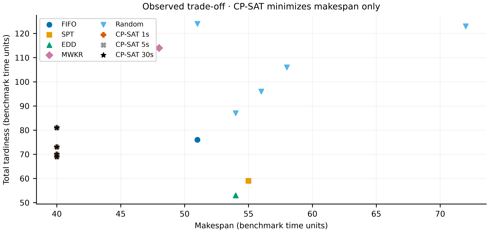

[PNG 크게 보기](publication/20261117T053721Z-c77ef3ce/objective_tradeoff.png) · [SVG 벡터 원본](publication/20261117T053721Z-c77ef3ce/objective_tradeoff.svg) · [PDF 원본](publication/20261117T053721Z-c77ef3ce/objective_tradeoff.pdf)

### 그림 16. CP-SAT의 정적 최적 스케줄

완료 시간 40인 정적 MK01 스케줄입니다. 세로축은 설비, 가로축은 벤치마크 시간이며 색과 작업 표시는 작업 배치를 나타냅니다. 고장이나 주문 도착을 반영한 동적 재계획 사례는 아닙니다.

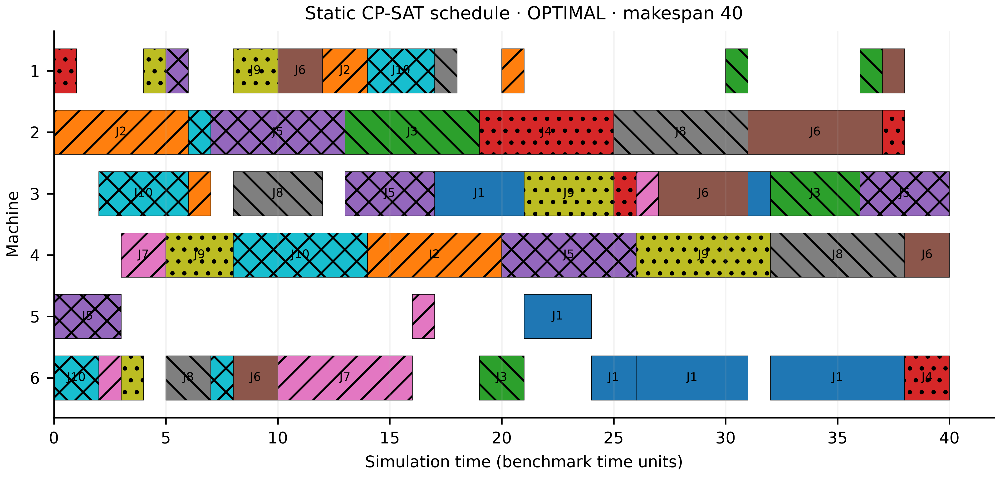

[PNG 크게 보기](publication/20261117T053721Z-c77ef3ce/cpsat_static_gantt.png) · [SVG 벡터 원본](publication/20261117T053721Z-c77ef3ce/cpsat_static_gantt.svg) · [PDF 원본](publication/20261117T053721Z-c77ef3ce/cpsat_static_gantt.pdf)

## 5. 최초 휴리스틱 구현과 납기 민감도

프로젝트 초기에 생성한 원본 그림도 모두 보존했습니다. 단일 실행과 합성 납기 반복 실험은 후속 CP-SAT·RL 비교의 반복 수에 더하지 않습니다. [초기 결과](../results/) · [단일 실행 코드](../src/run_baselines.py) · [납기 반복 코드](../src/run_phase1_repeated.py)

### 그림 17. 다섯 휴리스틱의 단일 실행 완료 시간

FIFO·SPT·EDD·MWKR·Random의 최초 정적 MK01 실행을 비교합니다. 정해진 규칙만으로도 스케줄을 만들 수 있다는 출발점이며, 이 단일 실행의 순위를 일반적인 우열로 해석하지 않습니다.

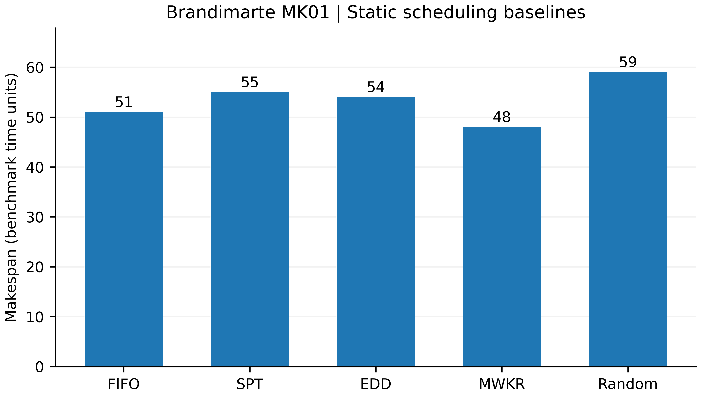

[PNG 크게 보기](mk01_makespan_comparison.png) · [SVG 벡터 원본](mk01_makespan_comparison.svg) · [PDF 원본](mk01_makespan_comparison.pdf)

### 그림 18. 50개 합성 납기 시나리오의 민감도

동일한 MK01의 합성 납기 시드를 50개로 바꾸고 다섯 방법을 실행한 결과입니다. 왼쪽은 완료 시간, 오른쪽은 총 납기지연의 분포입니다. Random 행동 시드도 함께 바뀝니다. 250개 평가 기록이지만 250개 독립 공장 구조는 아닙니다. 상자 그림에서 이상점 표시는 생략되어 있습니다.

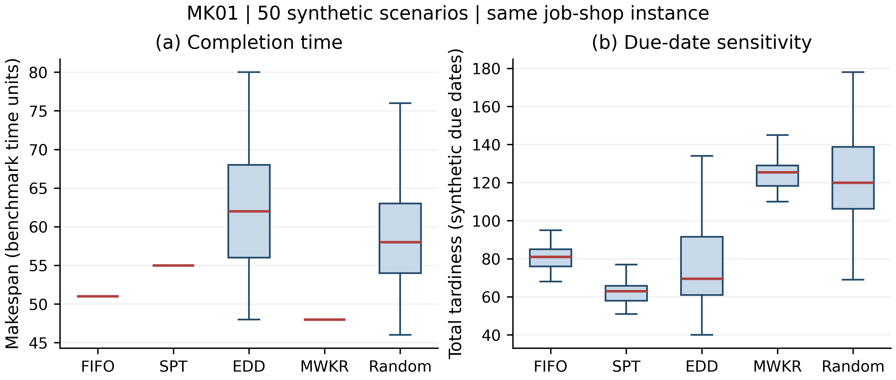

[PNG 크게 보기](phase1/mk01_50seed_heuristic_comparison.png) · [SVG 벡터 원본](phase1/mk01_50seed_heuristic_comparison.svg) · [PDF 원본](phase1/mk01_50seed_heuristic_comparison.pdf)

### 그림 19. FIFO 규칙의 정적 배치 사례

먼저 선택되는 작업 순서를 기준으로 배정하는 FIFO의 최초 실행입니다. 설비별 가공 구간과 빈 구간을 확인할 수 있습니다. 다른 초기 간트 차트와 동일 MK01 조건의 사례 비교입니다.

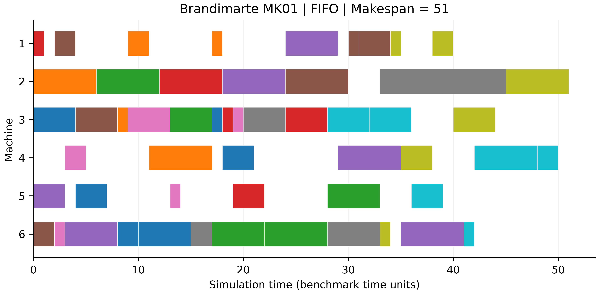

[PNG 크게 보기](mk01_fifo_gantt.png) · [SVG 벡터 원본](mk01_fifo_gantt.svg) · [PDF 원본](mk01_fifo_gantt.pdf)

### 그림 20. SPT 규칙의 정적 배치 사례

짧은 가공시간을 우선하는 SPT의 최초 실행입니다. 개별 작업을 짧게 처리하는 규칙이 전체 완료 시간을 최소화하는 것과 같지는 않음을 다른 배치와 비교해 볼 수 있습니다.

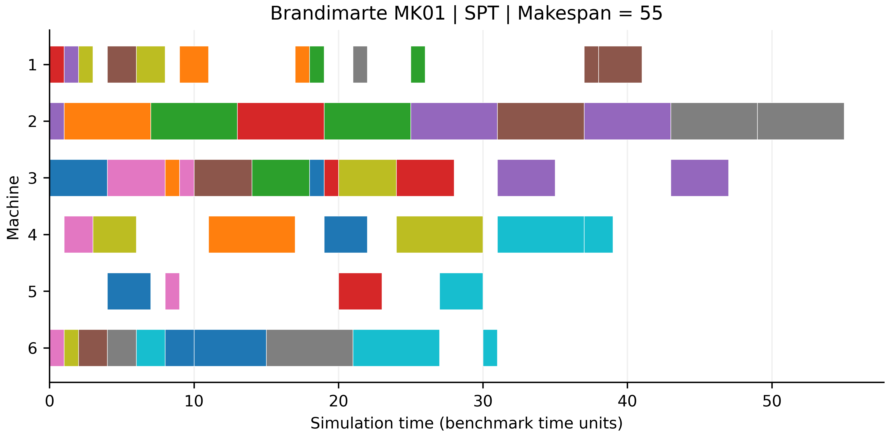

[PNG 크게 보기](mk01_spt_gantt.png) · [SVG 벡터 원본](mk01_spt_gantt.svg) · [PDF 원본](mk01_spt_gantt.pdf)

### 그림 21. EDD 규칙의 정적 배치 사례

합성 납기가 빠른 작업을 우선하는 EDD의 최초 실행입니다. 납기 정보는 원본 MK01에 있던 현장 납기가 아니라 프로젝트에서 생성한 값입니다.

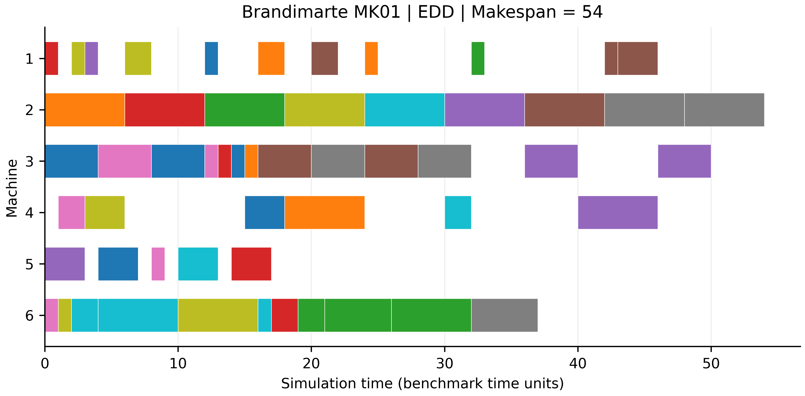

[PNG 크게 보기](mk01_edd_gantt.png) · [SVG 벡터 원본](mk01_edd_gantt.svg) · [PDF 원본](mk01_edd_gantt.pdf)

### 그림 22. MWKR 규칙의 정적 배치 사례

남은 작업량이 큰 작업을 우선하는 MWKR의 최초 실행입니다. 공정별 배치와 최종 완료 시점이 다른 규칙과 어떻게 달라지는지 보여줍니다.

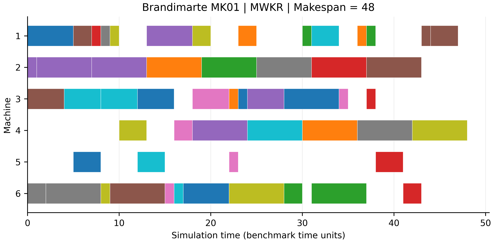

[PNG 크게 보기](mk01_mwkr_gantt.png) · [SVG 벡터 원본](mk01_mwkr_gantt.svg) · [PDF 원본](mk01_mwkr_gantt.pdf)

### 그림 23. 무작위 규칙의 정적 배치 사례

시드를 고정한 Random 규칙의 최초 실행입니다. 하나의 무작위 결과를 보여주므로 변동성은 위의 반복 실험과 함께 확인해야 합니다.

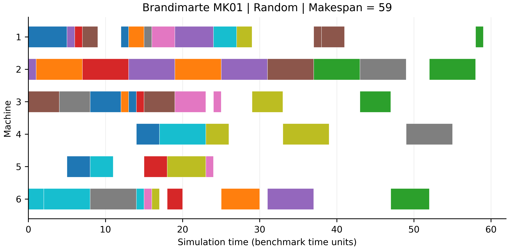

[PNG 크게 보기](mk01_random_gantt.png) · [SVG 벡터 원본](mk01_random_gantt.svg) · [PDF 원본](mk01_random_gantt.pdf)
